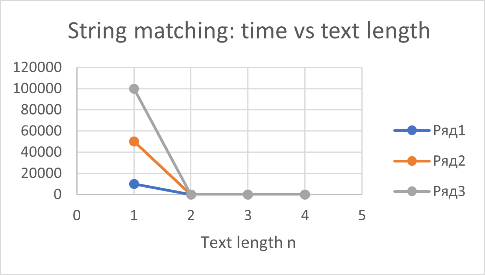
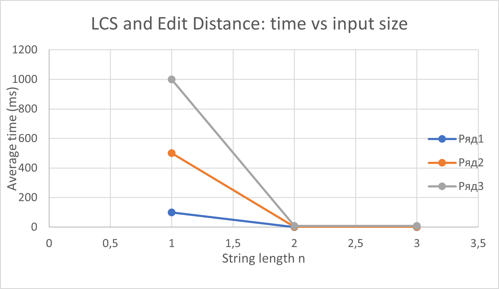

# Assignment 4 — Text Analysis: Dynamic Programming and String Algorithms

Java application that implements and compares:

* **Part A (dynamic programming):** Longest Common Subsequence (LCS) and Edit (Levenshtein) Distance
* **Part B (string matching):** Naive search, Knuth–Morris–Pratt (KMP), Rabin–Karp
* **Part C (advanced):** Kasai's algorithm for the Longest Common Prefix (LCP) array

The repository also contains tests for all algorithms, a reproducible experiment runner
(fixed seed, 5 timed runs, `System.nanoTime()`, operation counts), result tables and plots.
This README is the full report.

---

## 1. Problem description and algorithm overview

| Part | Problem | Algorithm | File |
|---|---|---|---|
| A | Length of the longest subsequence common to two strings | LCS, DP table | `src/algorithms/LCS.java` |
| A | Minimum number of insertions, deletions, substitutions between two strings | Edit distance, DP table | `src/algorithms/EditDistance.java` |
| B | All start indices of a pattern in a text | Naive (baseline) | `src/algorithms/NaiveSearch.java` |
| B | same | KMP (LPS / failure table) | `src/algorithms/KMP.java` |
| B | same | Rabin–Karp (rolling hash + verification) | `src/algorithms/RabinKarp.java` |
| C | LCP array from a string and its suffix array | Kasai | `src/algorithms/Kasai.java` |
| helper | Suffix array for tests/experiments (not a graded algorithm) | sort of suffixes | `src/algorithms/SuffixArrayBuilder.java` |

All algorithms are implemented by hand; no library search/matching method is used inside them.
Java standard libraries are used only for random data, collections, timing and (in tests) as an oracle.

## 2. Repository structure, build and run

```
assignment-4-text-analysis/
├── src/
│   ├── algorithms/     LCS, EditDistance, NaiveSearch, KMP, RabinKarp, Kasai, SuffixArrayBuilder
│   ├── experiments/    ExperimentRunner.java   (all benchmarks, writes results/results.csv)
│   └── Main.java       (runs the experiments)
├── tests/
│   └── TestRunner.java (83 checks)
├── results/            results.csv
├── plots/              dp_comparison.png, string_matching.png
├── README.md
└── .gitignore
```

Requirements: JDK 17 or newer. Run all commands from the repository root.

```
# Linux / macOS
mkdir -p out && javac -d out $(find src tests -name '*.java')
java -cp out TestRunner      # tests
java -cp out Main            # experiments -> results/results.csv
```

```
# Windows PowerShell
New-Item -ItemType Directory -Force out | Out-Null
javac -d out (Get-ChildItem -Recurse src,tests -Filter *.java).FullName
java -cp out TestRunner
java -cp out Main
```

The plots were created in a spreadsheet (Excel) from `results/results.csv`.

## 3. Implementation decisions and assumptions

* **Alphabet:** every random string uses `{a, b, c, d}` (4 letters). Fixed seed: `42` (`java.util.Random`);
  each experiment derives its own seed from it, so the inputs do not depend on the order of experiments.
* **Empty pattern:** it occurs at **every position `0..n`** of a text of length `n` (`n + 1` occurrences; for an empty text
  the result is `[0]`). All three matchers use this convention. If the pattern is longer than the text, the result is empty.
  Overlapping occurrences are reported (`aa` in `aaaaa` -> `0,1,2,3`). All results are start indices in ascending order.
* **LCS / Edit distance:** full `(m+1) x (n+1)` table; row 0 and column 0 are the base cases.
* **KMP:** `lps[i]` = length of the longest proper prefix of `pattern[0..i]` that is also its suffix.
  After a full match the search continues from `lps[m-1]`, so overlapping matches are found.
* **Rabin–Karp:** polynomial hash, base `256`, modulus `1_000_000_007` (all arithmetic in `long`).
  Every hash match is **verified character by character**, so the answer is always exact; hash matches that fail the
  verification are counted as *spurious hits* (collisions). An overload `search(text, pattern, base, mod)` lets the tests use
  a tiny modulus to force collisions.
* **Kasai:** `lcp[0] = 0` and `lcp[r] = LCP(suffix sa[r-1], suffix sa[r])`. The input suffix array is validated
  (must be a permutation of `0..n-1`, otherwise `IllegalArgumentException`).
  The suffix array itself is built by `SuffixArrayBuilder` (simple sort of suffixes, O(n² log n) worst case; allowed by
  the assignment) and is **never** inside the timed region.
* **Operation counts:**
    * LCS / Edit distance: number of table cells `n·n`.
    * Naive, KMP, Kasai: number of character comparisons (KMP includes building the LPS table).
    * Rabin–Karp: only comparisons made while verifying hash matches (rolling-hash arithmetic is not a comparison), plus a separate counter of spurious hits.
      The counters are `public static long comparisons` fields that are reset at the start of every call.

## 4. Complexity analysis

Notation: `n`, `m` = string lengths (for matching: `n` = text, `m` = pattern). This table is **theory**;
measured times are discussed in Section 9.

| Algorithm | Main operation / recurrence | Best case | Worst case | Auxiliary space | Justification |
|---|---|---|---|---|---|
| **LCS** | `dp[i][j] = dp[i-1][j-1] + 1` if `a[i-1]==b[j-1]`, else `max(dp[i-1][j], dp[i][j-1])`; `dp[i][0]=dp[0][j]=0` | Θ(n·m) | Θ(n·m) | O(n·m) | `(n+1)(m+1)` cells, O(1) per cell; the loops always run completely |
| **Edit distance** | `dp[i][j] = dp[i-1][j-1]` if equal, else `1 + min(insert, delete, replace)`; `dp[i][0]=i`, `dp[0][j]=j` | Θ(n·m) | Θ(n·m) | O(n·m) | same number of cells, O(1) per cell |
| **Naive** | try every shift, compare until the first mismatch | O(n) (first character mismatches at every shift) | O(n·m) (text `aⁿ`, pattern `aᵐ⁻¹b`) | O(1) | `n-m+1` shifts × up to `m` comparisons |
| **KMP** | LPS table; on mismatch `j = lps[j-1]`, text index never decreases | Θ(n + m) | Θ(n + m) | O(m) | preprocessing O(m); in the search `i` only grows and every fallback lowers `j` (which only grows when `i` grows), so at most `2n` comparisons |
| **Rabin–Karp** | rolling hash `h' = ((h − s[i]·B^(m-1))·B + s[i+m]) mod M`; verify on hash match | Θ(n + m) | O(n·m) | O(1) | O(1) per shift; **expected** O(n + m) because collisions are rare; worst case when many windows must be verified, e.g. text `aⁿ`, pattern `aᵐ` (every window is a true match) |
| **Kasai** | walk suffixes in text order, `k = max(k-1, 0)`, extend `k` while characters match | Θ(n) | Θ(n) | O(n) (`rank` array) + O(n) output | `k ≤ n`, it decreases by at most 1 per step and increases only by successful comparisons, so ≤ 2n successful + ≤ n failed comparisons |

**Expected vs. worst case.**
* *Naive* needs about `n·σ/(σ−1)` comparisons on random text (≈ 1.33·n for σ = 4), but `(n−m+1)·m` on `aⁿ` / `aᵐ⁻¹b`.
* *Rabin–Karp* is O(n + m) only **in expectation** (few collisions, few real matches). With many real matches every window is verified and it becomes O(n·m).
* *KMP* has no such gap: Θ(n + m) for every input.

## 5. Why the algorithms are correct

**LCS.** `dp[i][j]` is the LCS length of the prefixes `a[0..i)` and `b[0..j)`.
Base: an empty prefix shares nothing, so `dp[i][0] = dp[0][j] = 0`.
If the last characters are equal, some LCS ends with that character (otherwise it could be extended by it), so we remove it from both strings: `dp[i-1][j-1] + 1`.
If they differ, an LCS cannot match both last characters to each other, so it ignores at least one of them: it is an LCS of `(i-1, j)` or of `(i, j-1)` and we take the larger one.
Each cell depends only on cells that are computed earlier, so every sub-problem is solved once: O(n·m) instead of exponential recursion.

**Edit distance.** `dp[i][j]` is the minimum number of edits turning `a[0..i)` into `b[0..j)`.
Base: `dp[i][0] = i` (delete `i` characters), `dp[0][j] = j` (insert `j` characters).
Look at the last operation of an optimal script: the last characters are aligned (cost `dp[i-1][j-1]` plus 0 if equal, 1 for a replacement), or `a[i-1]` is deleted (`dp[i-1][j] + 1`), or `b[j-1]` is inserted (`dp[i][j-1] + 1`). The remainder is an optimal sub-problem, so the minimum of these options is optimal.

**KMP — how repeated comparisons are avoided.** `lps[j-1]` is the longest proper border of the `j` characters matched so far.
After a mismatch the longest suffix of the text read so far that can still be a pattern prefix has exactly this length, so those characters are *already known to match* and are not compared again. The text index never moves backwards, whereas Naive re-reads the same text characters for many shifts.

**Rabin–Karp — how collisions are handled.** Different strings may have the same hash, so a hash match is only a candidate and is verified character by character. A collision only costs time (a spurious hit) and never produces a wrong answer. With a prime modulus ≈ 10⁹ collisions are rare. The tests use modulus 7 to force many collisions and check that the results are still exact.

**Kasai and the LCP array.** The suffix array `sa` lists the start positions of all suffixes in lexicographic order. `lcp[r]` is the length of the longest common prefix of the **neighbouring** suffixes `sa[r-1]` and `sa[r]`. Because neighbours share the longest prefixes, the LCP of any two suffixes is the minimum of `lcp` between their ranks, and `max(lcp)` is the length of the longest repeated substring.
Kasai processes suffixes in **text order** and keeps `k`, the LCP of suffix `i` with its predecessor in the suffix array. If `k > 0`, suffix `i+1` has an LCP of at least `k − 1` with its own predecessor (remove the shared first character), so the next step starts from `k − 1` instead of 0. That is why the total work is linear.

**Manual example — `banana`:**

| r | `sa[r]` | suffix | `lcp[r]` |
|---|---|---|---|
| 0 | 5 | `a` | 0 |
| 1 | 3 | `ana` | 1 (`a`) |
| 2 | 1 | `anana` | 3 (`ana`) |
| 3 | 0 | `banana` | 0 |
| 4 | 4 | `na` | 0 |
| 5 | 2 | `nana` | 2 (`na`) |

So `sa = [5, 3, 1, 0, 4, 2]` and `lcp = [0, 1, 3, 0, 0, 2]`; the longest repeated substring is `ana`.

## 6. Testing strategy and results

`java -cp out TestRunner` runs **83 checks; all pass** (exit code 1 if any fails).
Strategy: the edge cases required by the assignment, well-known textbook values, hand-computed structures, randomized cross-checks against an oracle / brute force, and invalid-input checks.

| Suite | What is tested |
|---|---|
| **LCS** | identical strings; completely different strings; first / second / both strings empty; `AGGTAB`/`GXTXAYB` = 4; `ABCBDAB`/`BDCABA` = 4; symmetry |
| **Edit distance** | identical; both empty; one empty (both directions); substitution `cat→cut` = 1; insertion `cat→cart` = 1; deletion `cart→cat` = 1; `kitten→sitting` = 3; `sunday→saturday` = 3; symmetry |
| **String matching** (Naive, KMP, Rabin–Karp, each checked against the expected list **and** against each other) | pattern at the beginning, in the middle, at the end; multiple occurrences; overlapping occurrences; pattern absent; pattern longer than text; pattern equals text; empty pattern; empty pattern + empty text; empty text; 2000 random cases against an oracle (`String.startsWith`, used only in tests) |
| **KMP LPS table** | `ababaca`, `aabaaab`, `aaaa`, `abcd` |
| **Rabin–Karp collisions** | 500 random cases with modulus 7: results exact and spurious hits really occurred; normal modulus: 0 spurious hits on a simple input |
| **Kasai** | `banana`, `abracadabra`, `mississippi` with manually verified suffix and LCP arrays; `aaaa`; single character; empty string; 300 random strings against a brute-force LCP; comparisons ≤ 3n; invalid suffix arrays (wrong length, duplicate, out of range) are rejected |

The experiment runner additionally checks (outside the timed region) that Naive, KMP and Rabin–Karp return identical index lists for every workload and that Kasai equals the brute-force LCP; it stops with an exception otherwise.

## 7. Experimental setup

| Experiment | Input sizes | Input |
|---|---|---|
| LCS | two strings of length 100, 500, 1000 | random, alphabet `{a,b,c,d}` |
| Edit distance | two strings of length 100, 500, 1000 | the same pairs as LCS |
| String matching | text length 10 000, 50 000, 100 000 | random text; pattern length 50 |
| Kasai | string length 1000, 5000, 10 000 | random string; suffix array built beforehand |

* **Pattern present:** the 50 characters from the middle of the text. **Pattern absent:** a random 50-character string verified (outside timing) not to occur in the text. Naive, KMP and Rabin–Karp always get the same text and pattern.
* **Additional (optional) adversarial workloads**, text `aⁿ`: pattern `a⁹⁹b` (no match, worst case for Naive) and pattern `a¹⁰⁰` (match at every position, worst case for Rabin–Karp).
* **Timing:** `System.nanoTime()` around the algorithm call only. Before measurements: a global JVM warm-up on different inputs, then 3 untimed runs for each configuration; then **5 timed runs, the average is reported**. Input generation, suffix-array construction, correctness checks, console output and file writing are outside the timed region.
* **Operation counts** are deterministic (identical on every machine).

## 8. Results

All times are the **average of 5 runs in milliseconds** (from `results/results.csv`).

### 8.1 LCS and Edit distance

| n | DP cells (n·n) | LCS time, ms | LCS length | Edit distance time, ms | Edit distance |
|---|---|---|---|---|---|
| 100 | 10 000 | 0.0909 | 61 | 0.0926 | 56 |
| 500 | 250 000 | 2.17 | 320 | 2.03 | 262 |
| 1000 | 1 000 000 | 7.55 | 647 | 8.62 | 524 |



### 8.2 String matching on random text (required workloads)

Cells show time in ms; the number of character comparisons is in parentheses.
For Rabin–Karp the comparisons are only the verification comparisons; there were 0 spurious hits in all runs.

**Pattern present**

| Text length | Occurrences | Naive | KMP | Rabin–Karp |
|---|---|---|---|---|
| 10 000 | 1 | 0.0688 ms (13 414) | 0.0668 ms (12 567) | 0.152 ms (50) |
| 50 000 | 1 | 0.387 ms (66 488) | 0.384 ms (62 494) | 0.747 ms (50) |
| 100 000 | 1 | 0.708 ms (133 776) | 0.641 ms (123 705) | 1.51 ms (50) |

**Pattern absent**

| Text length | Occurrences | Naive | KMP | Rabin–Karp |
|---|---|---|---|---|
| 10 000 | 0 | 0.0702 ms (13 230) | 0.0719 ms (12 377) | 0.152 ms (0) |
| 50 000 | 0 | 0.381 ms (66 602) | 0.512 ms (62 555) | 0.843 ms (0) |
| 100 000 | 0 | 0.617 ms (132 981) | 0.583 ms (124 895) | 1.50 ms (0) |



### 8.3 Adversarial workloads (additional)

| Workload | Text length | Naive | KMP | Rabin–Karp |
|---|---|---|---|---|
| text `aⁿ`, pattern `a⁹⁹b` (no match) | 10 000 | 2.88 ms (990 100) | 0.104 ms (20 098) | 0.153 ms (0) |
| | 50 000 | 14.5 ms (4 990 100) | 0.279 ms (100 098) | 0.737 ms (0) |
| | 100 000 | 25.1 ms (9 990 100) | 0.559 ms (200 098) | 1.55 ms (0) |
| text `aⁿ`, pattern `a¹⁰⁰` (match everywhere) | 10 000 | 3.26 ms (990 100) | 0.663 ms (10 099) | 6.07 ms (990 100) |
| | 50 000 | 13.4 ms (4 990 100) | 0.640 ms (50 099) | 21.8 ms (4 990 100) |
| | 100 000 | 26.8 ms (9 990 100) | 1.58 ms (100 099) | 34.4 ms (9 990 100) |

### 8.4 Kasai's algorithm

| n | time, ms | character comparisons | comparisons / n | max LCP |
|---|---|---|---|---|
| 1000 | 0.00560 | 1 987 | 1.99 | 10 |
| 5000 | 0.0605 | 9 989 | 2.00 | 13 |
| 10 000 | 0.132 | 19 988 | 2.00 | 11 |

## 9. Discussion: theory vs. experiment

Theory (Section 4) describes how the cost *grows*; measurements show the constant factors on one machine.

**LCS and Edit distance (Θ(n·m)).** The operation count is exactly `n²` (10⁴, 2.5·10⁵, 10⁶). From n = 100 to 500 the number of cells grows ×25; the measured time grew ×23.9 for LCS and ×21.9 for Edit distance. From n = 500 to 1000 the cells grow ×4; the time grew ×3.5 (LCS) and ×4.3 (Edit distance). The time per cell stays almost constant (≈ 7.5–9.3 ns), so the measurements agree with quadratic growth. Both algorithms have the same asymptotic cost; the small differences between them are constant factors and measurement noise.

**String matching on random text.** All three algorithms grow roughly linearly: a 10× longer text (10 000 → 100 000) took about 10× the time for a present pattern (×10.3 Naive, ×9.6 KMP, ×9.9 Rabin–Karp) and 8–10× for an absent pattern. Naive makes about 1.33·n comparisons (13 414 for n = 10 000), which matches the expectation `n·σ/(σ−1)` for σ = 4: most shifts fail after one or two characters, so its O(n·m) worst case is not reached. KMP makes slightly fewer comparisons (12 567, including building the LPS table), but because Naive's mismatches also come early, their running times are practically the same; differences of a few percent (e.g. 0.381 ms vs. 0.512 ms for n = 50 000, absent) are measurement noise. **Rabin–Karp makes almost no comparisons (50 or 0) but is the slowest, about 2.1–2.6 times slower than Naive and KMP at n = 100 000.** Its cost is the per-character rolling-hash arithmetic (multiplications and `%`), which is more expensive than a single character comparison; fewer comparisons therefore do not always mean less time. Present and absent patterns behave similarly because every algorithm has to scan the whole text.

**Adversarial workloads.** For text `aⁿ` and pattern `a⁹⁹b` (n = 100 000) Naive makes 9 990 100 comparisons (≈ n·m) and KMP only 200 098 (≈ 2n): ≈ 50× fewer. The measured times are 25.1 ms vs. 0.559 ms, ≈ 45× — on this machine the time follows the number of comparisons closely. Naive's time grows ≈ 8.7× for a 10× longer text, i.e. linearly in n for a fixed pattern length. Rabin–Karp does no comparisons (the hash never matches), and its time (1.55 ms) is the same as on random text, because the hashing cost does not depend on the data. For text `aⁿ` and pattern `a¹⁰⁰` every window is a real match, so Rabin–Karp verifies all windows (9 990 100 comparisons) and becomes the **slowest** algorithm (34.4 ms vs. 1.58 ms for KMP): this is its O(n·m) worst case and shows that its O(n + m) bound holds only in expectation. KMP stays linear (100 099 comparisons). In this workload all algorithms also build a result list with ≈ 10⁵ indices, which is a common cost.

**Kasai (Θ(n)).** The number of comparisons is ≈ 2·n for every size (1.99·n, 2.00·n, 2.00·n), below the 3n bound from Section 4, which confirms linear work. The measured time grew ×10.8 when n grew ×5 (1000 → 5000) and ×2.2 when n grew ×2 (5000 → 10 000). The first step is larger than linear; at 0.0056 ms the measurement is dominated by fixed overheads and noise, and possibly by memory access effects (not investigated). The operation count shows that the algorithm itself does linear work. Building the suffix array (not timed) is much more expensive than Kasai.

**Limits of the measurements.** One machine, one seed, 5 runs and JVM timing: small differences and sub-millisecond times are noisy (for example KMP on `aⁿ`/`a¹⁰⁰` took 0.663 ms for n = 10 000 and 0.640 ms for n = 50 000). Conclusions are therefore drawn only from large, consistent effects (quadratic vs. linear growth, the ≈ 50× difference in comparisons on adversarial input, the Rabin–Karp slowdown). Operation counts are exact; running times are indicative.

## 10. Conclusion and trade-offs

* **Dynamic programming** (LCS, edit distance): Θ(n·m) time and O(n·m) memory for the full table. The table allows reconstructing the answer; if only the value is needed, two rows are enough (O(min(n, m)) memory). Quadratic growth is the limit for very long strings.
* **Naive search:** simplest, no extra memory, fast on random text over a normal alphabet (~1.3·n comparisons), but O(n·m) on repetitive input.
* **KMP:** guaranteed Θ(n + m) for every input, O(m) memory for the LPS table; the safest choice for repetitive texts, though not much faster than Naive on random text.
* **Rabin–Karp:** O(1) extra memory and easy to extend (multiple patterns), expected O(n + m), but it depends on few collisions and few real matches; on random text it was slowest despite the fewest comparisons, and with many real matches it degrades to O(n·m).
* **Kasai:** linear time and O(n) memory for the LCP array; its limitation is that a suffix array must be built first (here with a simple O(n² log n) sort).

**Limitations of this work:** the suffix array comes from a simple sort (allowed by the assignment); edit distance returns only the distance (not the edit script); Rabin–Karp uses a single hash function; measurements come from a single machine.
[Main.java](src/Main.java)